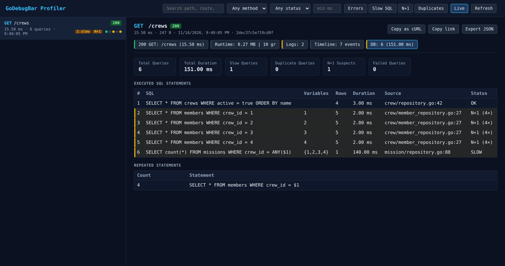

# godebugbar

[](https://pkg.go.dev/github.com/DarkoKlisuric/godebugbar)
[](https://goreportcard.com/report/github.com/DarkoKlisuric/godebugbar)
[](https://github.com/DarkoKlisuric/godebugbar/actions/workflows/ci.yml)
[](https://github.com/DarkoKlisuric/godebugbar/releases)

godebugbar is a debug toolbar and request profiler for Go web apps. It shows SQL queries with N+1 detection, logs, outgoing HTTP calls and a timeline for every request. Works with net/http, Gin, GORM, pgx and database/sql.



For development only. Profiling is off by default.

## Features

- SQL query profiler with caller file and line
- N+1 and duplicate query detection
- Slow queries and EXPLAIN for PostgreSQL
- Request and response inspector: headers, body, status, route
- `slog` logs and outgoing HTTP calls per request
- Timeline with your own spans
- Toolbar for server-rendered pages and SPAs
- Custom collectors

## Install

```bash
go get github.com/DarkoKlisuric/godebugbar@latest
```

Adapters for Gin, GORM, pgx and `database/sql` are separate modules. Add only the ones you use.

## Use

```go
bar := godebugbar.New(godebugbar.WithEnabled(true))
http.ListenAndServe(":8080", bar.Middleware(mux))
```

Open `http://localhost:8080/_debugbar`.

### Gin and GORM

```bash
go get github.com/DarkoKlisuric/godebugbar/adapter/gin@latest github.com/DarkoKlisuric/godebugbar/adapter/gorm@latest
```

```go
router := gin.New()

godebugbar.New(
	godebugbar.WithEnabled(true),
	ginadapter.Attach(router), // before any route
	gormadapter.Attach(db),
)
```

Queries are recorded when they run with the request context: `db.WithContext(ctx)`.

### Other databases

```bash
go get github.com/DarkoKlisuric/godebugbar/adapter/pgx@latest   # pgx v5
go get github.com/DarkoKlisuric/godebugbar/adapter/sql@latest   # database/sql
```

| Driver | Setup |
| :--- | :--- |
| pgx v5 | `config.ConnConfig.Tracer = pgxadapter.NewTracer()` and `pgxadapter.Attach()` |
| `database/sql` | `db, _ := sqladapter.Open("pgx", dsn)` and `sqladapter.Attach()` |

### Toolbar

Server-rendered pages: add `godebugbar.WithHTMLInjection()`.

Single-page apps: load the script before your app bundle.

```html
<script src="http://localhost:8080/_debugbar/assets/toolbar.js"
        data-base-url="http://localhost:8080/_debugbar"></script>
```

On another origin, also pass `godebugbar.WithCORS("http://localhost:5173")`.

The toolbar shows numbers for the current page: requests, time, queries, errors. They reset when you change page.

### Record your own data

```go
req := godebugbar.FromContext(ctx) // nil-safe
req.AddError(err)
req.Log(slog.LevelWarn, "cache miss")
defer req.StartSpan("render")()
```

Capture logs and outgoing calls:

```go
logger := slog.New(godebugbar.NewSlogHandler(handler))
client := &http.Client{Transport: godebugbar.NewTransport(nil)}
```

### Custom collector

```go
type UserCollector struct{}

func (c *UserCollector) Name() string { return "user" }

func (c *UserCollector) Collect(ctx context.Context, _ *http.Request, _ *godebugbar.ResponseInfo) *godebugbar.Section {
	panel := godebugbar.NewPanel("User").AddKeyValue("User", map[string]string{"id": userID(ctx)})
	return godebugbar.NewSection(godebugbar.ToolbarItem{Label: "User", Value: userID(ctx)}, panel)
}

godebugbar.New(godebugbar.WithEnabled(true), godebugbar.WithCollectors(&UserCollector{}))
```

## Search

The profiler page and `GET /_debugbar/api/profiles` filter by:

| Parameter | Example | Matches |
| :--- | :--- | :--- |
| `q` | `q=users` | path, route, id, SQL, error text |
| `method` | `method=POST` | HTTP method |
| `status` | `status=5` or `status=404` | status class or exact status |
| `min_ms` | `min_ms=100` | slower requests |
| `has` | `has=error,slow,n_plus_one,duplicate,panic` | requests with these problems |
| `limit` | `limit=20` | first N results |

Searches are links: `/_debugbar?q=users&has=slow`.

## Options

| Option | Default | Does |
| :--- | :--- | :--- |
| `WithEnabled(bool)` | `false` | Turns profiling on |
| `WithAuthorizer(func(*http.Request) bool)` | everyone | Who can see profiles |
| `WithCORS(origins...)` | none | Origins allowed to read profiles |
| `WithHTMLInjection()` | off | Adds the toolbar to HTML pages |
| `WithRedactedHeaders(names...)` | credentials | More headers to mask |
| `WithRedactedQueryParams(names...)` | token, password… | More query parameters to mask |
| `WithRedactedBodyFields(names...)` | password, token… | More body fields to mask |
| `WithHiddenSQLValues()` | off | Keeps SQL placeholders only |
| `WithRequestBody(maxBytes)` | off | Captures request bodies |
| `WithSlowQueryThreshold(d)` | `100ms` | Slow query limit |
| `WithNPlusOneThreshold(n)` | `3` | Repeats that count as N+1 |
| `WithSourceSkip(patterns...)` | none | Frames to skip when finding a query's caller |
| `WithStorageSize(n)` | `50` | Profiles kept |
| `WithPersistence(path)` | off | Keeps profiles across restarts |
| `WithEntryLimit(n)` | `500` | Entries kept per request |
| `WithPrefix(prefix)` | `/_debugbar` | Profiler URL prefix |
| `WithPublicURL(url)` | prefix | Profiler URL the browser uses |
| `WithServeEndpoints(bool)` | `true` | Serve the profiler from the middleware |
| `WithDashboard(bool)` | `true` | Serve the profiler page |
| `WithMaxHTMLBuffer(bytes)` | 4 MiB | Largest page that gets the toolbar |
| `WithExcludedPaths(paths...)` | none | Paths not profiled |
| `WithExcludedPrefixes(prefixes...)` | none | Path prefixes not profiled |
| `WithExcludedMethods(methods...)` | `OPTIONS` | Methods not profiled |
| `WithCollectors(c...)` | none | Custom collectors |
| `WithQueryCollector()` | via adapters | SQL collector |
| `WithoutDefaultCollectors()` | off | Drops the built-in collectors |

Run the profiler on a private port with `bar.Handler()`, `WithServeEndpoints(false)` and `WithPublicURL(...)`.

## Development

```bash
make test               # unit tests with -race, every module
make test-integration   # PostgreSQL tests (DATABASE_URL)
make lint               # golangci-lint and codecheck
make fmt                # gofumpt and goimports
make tidy               # go mod tidy in every module
```

Releases follow `CONTRIBUTING.md`.
